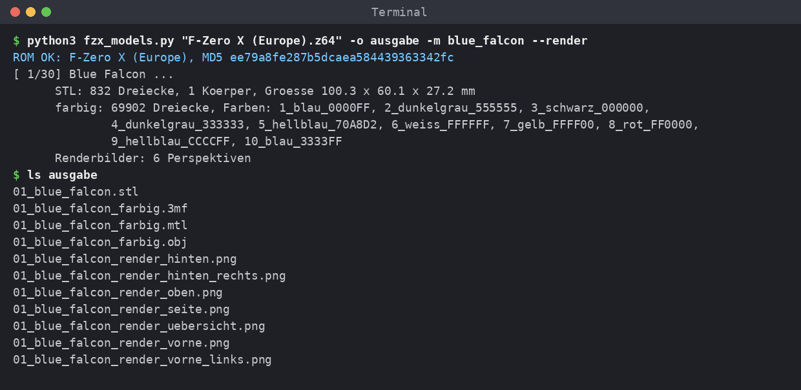

# F-ZeroX-3MF

A Python script that exports the vehicles from **your own ROM of *F-Zero X* (N64, European/PAL version)** as 3D-printable models: watertight **STL** files and **color 3MF** files painted like in the game.

> ⚠️ **This repository contains no game data.** It contains no models, no textures and no ROM. The script reads all geometry and color data from your own ROM every time it runs. Please do not upload generated models, renders or ROMs to this repository.



## What the script produces

For each of the 30 vehicles:

| File | Contents |
|---|---|
| `NN_name.stl` | Closed, watertight solid built from the original polygons (highest level of detail), single color |
| `NN_name_farbig.3mf` | The same model with its faces split along the color borders of the textures (race numbers, lettering, stripes). Colors are stored as filament painting, which OrcaSlicer, Anycubic Slicer Next and Bambu Studio can read. |
| `NN_name_farbig.obj` + `.mtl` | Color model as OBJ with material colors |
| `NN_name_render_*.png` | only with `--render`: renders from 6 viewpoints plus an overview image |
| `00_uebersicht.png` | only with `--render`: all generated vehicles with their colors in one image |

(*farbig* = colored, *uebersicht* = overview. The script's output and file names are in German.)

Further properties:
- **Scale:** All vehicles share the same scale; the Blue Falcon is 100 mm long. Change it with `--length`.
- **Thin surfaces:** Fins and wings have zero thickness in the game. The script thickens them to 1.2 mm (`--thick`).
- **Floating parts:** Parts that float freely in the game get a small strut connecting them to the body.
- **Colors:** All colors of a vehicle are kept; depending on the vehicle that is about 6 to 11. Lettering edges are smoothed (Scale2x); use `--smooth 1` for the pixel-exact original look.

## Requirements

### 1. The European ROM (PAL)

The script **only works with the European version** of F-Zero X. The US and Japanese versions use different addresses and are rejected.

| | |
|---|---|
| Game | F-Zero X (Europe), N64, revision 0, game code `NFZP` |
| MD5 (.z64) | `ee79a8fe287b5dcaea584439363342fc` |
| SHA-1 (.z64) | `af9038bcb543a2b4faaab876dbdab4663859e092` |
| Size | 16 MiB (16,777,216 bytes) |

The script checks the MD5 checksum every time it starts and stops with an error message if the ROM is different. The `.v64` (byte-swapped) and `.n64` (little-endian) formats are converted to `.z64` automatically before the check. The checksum above applies to the `.z64` data.

To check your ROM yourself:

```bash
# Linux
md5sum "F-Zero X (Europe).z64"
# macOS
md5 "F-Zero X (Europe).z64"
# Windows (PowerShell)
Get-FileHash "F-Zero X (Europe).z64" -Algorithm MD5
```

The ROM is **not** included. Make a backup of your own cartridge, for example with a cartridge dumper.

### 2. Python 3.10 or newer

The script was tested with Python 3.13. Check with `python3 --version`. On Windows the command is usually `py` or `python`.

### 3. Python packages

```bash
pip install -r requirements.txt
```

This installs:

| Package | Used for |
|---|---|
| `numpy`, `scipy` | Computation |
| `trimesh`, `rtree` | Mesh processing and watertightness checks |
| `manifold3d` | Boolean union into a single closed solid |
| `triangle` | Splitting faces along color borders |
| `pillow` | Renders |

A separate virtual environment is recommended:

```bash
python3 -m venv .venv
source .venv/bin/activate        # Windows: .venv\Scripts\activate
pip install -r requirements.txt
```

No graphics driver or Blender is needed. The script computes the renders itself.

## Usage

```bash
# all 30 vehicles as STL + color 3MF/OBJ
python3 fzx_models.py "F-Zero X (Europe).z64" -o output

# also renders from 6 viewpoints + overall overview
python3 fzx_models.py "F-Zero X (Europe).z64" -o output --render

# only specific vehicles (names: see --list)
python3 fzx_models.py "F-Zero X (Europe).z64" -o output -m blue_falcon -m golden_fox

# list all vehicles (no ROM needed)
python3 fzx_models.py --list
```

Run time: about 4 seconds per vehicle, about 30 seconds with `--render`.

### Options

| Option | Meaning | Default |
|---|---|---|
| `-o DIR` | Output directory | `fzerox_modelle` |
| `-m NAME` | Only this vehicle; can be given multiple times | all |
| `--length MM` | Length of the Blue Falcon in mm. All other vehicles are scaled by the same factor. | `100` |
| `--thick MM` | Minimum thickness for zero-thickness surfaces | `1.2` |
| `--skin 0-3` | Paint scheme: 0 = default, 1–3 = the alternative paint schemes from the game | `0` |
| `--smooth N` | Edge smoothing for decals: `1` = pixel-exact, `2/4/8/16` = pixel-art upscaling | `8` |
| `--max-colors N` | Upper limit for the number of colors | `16` |
| `--merge DE` | Merge colors whose color difference (CIE Delta E) is below this value | `12` |
| `--map "8=1,4=3"` | Merge specific colors, e.g. color 8 → 1. The numbers are shown in the output. | – |
| `--no-color` | Only create STL files | – |
| `--render` | Create renders | – |
| `--views a,b,…` | Viewpoints: `vorne_links` (front left), `hinten_rechts` (rear right), `seite` (side), `oben` (top), `vorne` (front), `hinten` (rear) | all |
| `--render-size WxH` | Render size in pixels | `2400x1600` |

## Multi-color printing

1. In your slicer, first select a **multi-color printer**, for example one with an Anycubic ACE, Bambu AMS or Prusa MMU.
2. Add **as many filaments as the vehicle has colors** and set their colors in the order listed in the script's output. The order is also shown in the overview image.
3. **Only then** drag the `_farbig.3mf` file into the project.

If too few filaments are set up when the file is loaded, slicers of the Orca family reset the extra colors to filament 1, and the model appears single-colored. If you have fewer filament slots than colors, you can assign the same spool to several filaments or merge colors with `--map`.

With a **single-color printer**, print the `.stl` and paint it afterwards. The renders can serve as a reference.

## How it works

1. **Read and check the ROM:** The script checks the ROM's MD5 checksum.
2. **Geometry:** The game does not store the vehicles as finished models; they are built at runtime by code (display lists). The script contains a compact description of these display lists: ROM addresses of the vertices and textures plus triangle indices. It is derived from the public decompilation project [inspectredc/fzerox](https://github.com/inspectredc/fzerox), which is released under CC0. The actual coordinates, textures and colors are read from your ROM.
3. **Colors:** The N64 color combiner is recomputed, i.e. body color, decal textures, and primitive and environment colors. Matching shades are merged into a palette.
4. **Color regions:** Every triangle is split along the color borders of its texture (constrained Delaunay triangulation). The split points on shared edges match exactly, so the mesh stays closed.
5. **Solid:** Closed shells are kept and small holes are filled. Double-sided surfaces become plates with a minimum thickness. Everything is merged with [Manifold](https://github.com/elalish/manifold) into a single watertight solid.
6. **Export:** STL, OBJ/MTL and 3MF with filament painting. The painting is stored in the `paint_color` attribute for Orca and Bambu and additionally in `slic3rpe:mmu_segmentation` for the PrusaSlicer format.

## Legal

- *F-Zero*, *F-Zero X* and the names of the vehicles and characters are trademarks or copyrighted works of **Nintendo**. This project is not affiliated with, endorsed by or reviewed by Nintendo.
- This repository contains **no** copyrighted game data: no ROM, no models, no textures, no images from the game. The embedded addresses and indices come from the CC0-licensed decompilation project [inspectredc/fzerox](https://github.com/inspectredc/fzerox).
- Only use the script with a ROM you legally own. The generated models are intended for **private use**. Please do not publish or sell them.
- The code of this project is released under the [MIT License](LICENSE).
